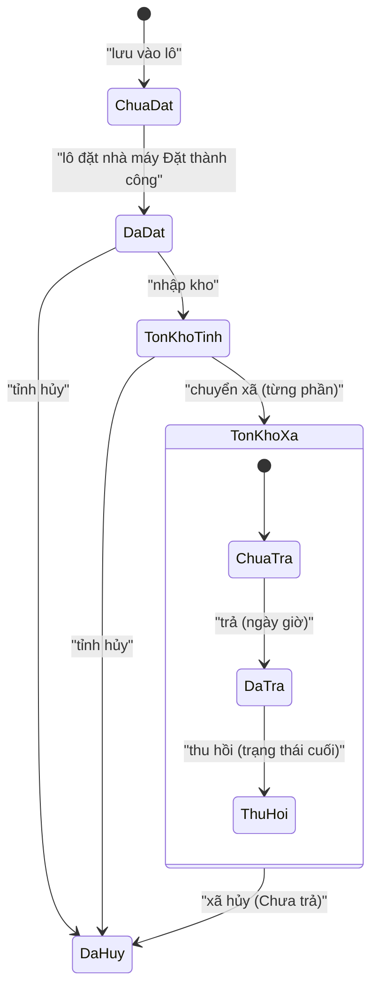
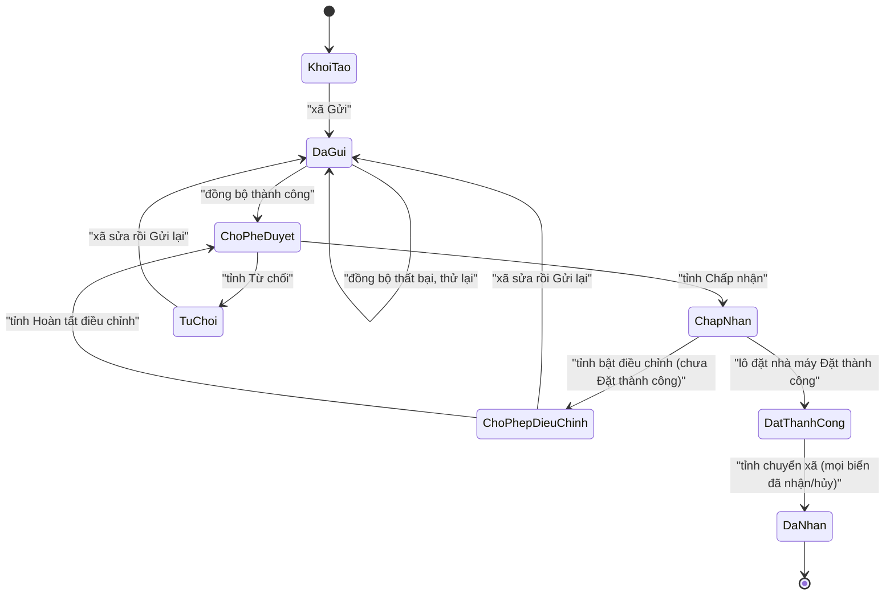
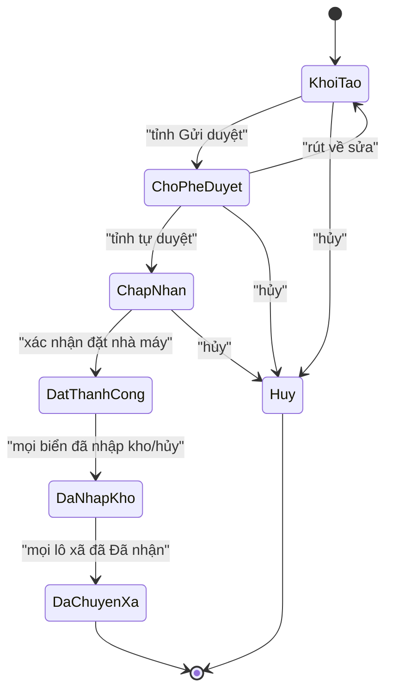
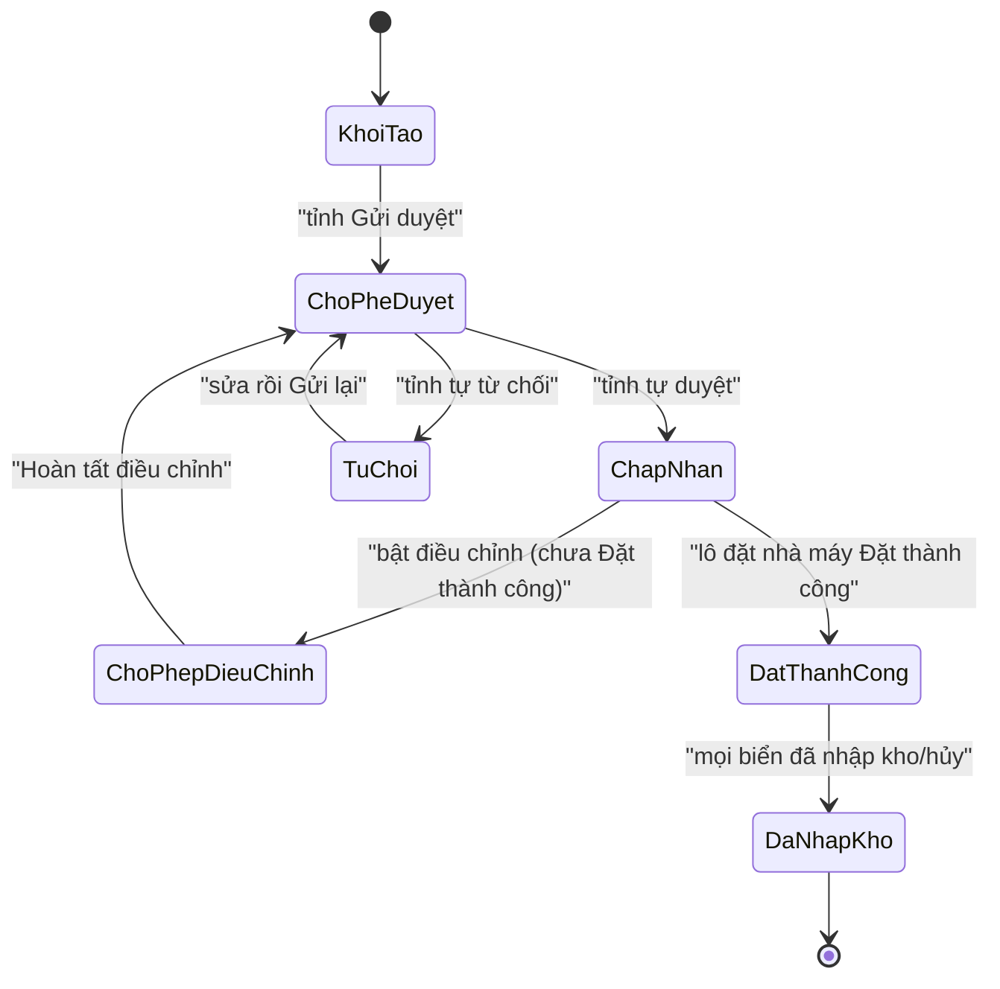

# Spec: Phần mềm quản lý đặt và cấp phát biển số xe (34 tỉnh/thành)

- **Trạng thái:** Đã duyệt (2026-10-21; cập nhật 2026-10-22; xác nhận G-15…G-18 ngày 2026-10-28)
- **Ngày:** 2026-10-16 (rà soát giả định: 2026-10-21)
- **Thư mục:** `specs/001-quan-ly-bien-so-xe/`
- **Nguồn:** `SRS.docx` (bản nháp ý tưởng) + kết quả phân tích/kiểm tra + các quyết định của người dùng ngày 2026-10-16
- **Dữ liệu danh mục kèm theo:** thư mục [`data/`](./data/) (xem Phụ lục A)

> Đây là **phần mềm nội bộ**. Định dạng biển số và quy trình trong spec này là quy ước của phần mềm,
> không phụ thuộc quy định hiện hành của cơ quan nhà nước và không bị ràng buộc bởi chúng.

---

## 1. Bối cảnh & vấn đề

Việc đặt và cấp phát biển số xe ở 34 tỉnh/thành và 3.321 xã/phường/đặc khu đang thiếu một công cụ thống
nhất. Mỗi xã/phường lập danh sách biển cần đặt, gửi lên tỉnh/thành; tỉnh/thành duyệt, gom lại đặt nhà máy,
nhập kho rồi chuyển lại cho xã/phường; xã/phường trả biển cho người dân.

Vấn đề cần giải quyết:
- Không có nguồn dữ liệu chung, khó kiểm tra **biển trùng** giữa các lô, các xã và kho.
- Trạng thái từng lô không rõ ràng, không truy vết được ai đã làm gì, khi nào.
- Thiếu kiểm soát tài khoản, mật khẩu và phân quyền theo cấp hành chính.
- Không có thống kê tồn kho, tiến độ đặt, tiến độ trả biển cho người dân.

Tài liệu SRS gốc mới ở mức ý tưởng: thiếu phạm vi, thuật ngữ, phi chức năng, ràng buộc import, tiêu chí
nghiệm thu, và có nhiều mâu thuẫn/lỗi biên soạn. Spec này thay thế SRS làm nguồn sự thật.

## 2. Mục tiêu / Không phải mục tiêu

**Mục tiêu**
- Quản lý tập trung 3 cấp tài khoản: Admin, Tỉnh/thành, Xã/phường.
- Số hóa trọn vòng đời lô biển: lập lô → gửi → duyệt → đặt nhà máy → nhập kho → chuyển xã → trả người dân.
- Đảm bảo **tính duy nhất** của biển số trong phạm vi tỉnh/thành.
- Bảo mật tài khoản theo thông lệ phổ biến (chính sách mật khẩu, khóa, 2 lớp cho Admin, audit log).
- Cung cấp tra cứu, báo cáo/thống kê theo đúng phạm vi quyền.

**Ngoài phạm vi (out of scope)**
- Đối chiếu **chặn** giữa **mã tỉnh nội bộ (01–34)** và **mã biển số `D1D2`**: không làm; chỉ **cảnh báo và ghi cờ** (xem FR-038). Hai khái niệm
  vẫn độc lập về dữ liệu; hệ thống chỉ cảnh báo khi `MaTinh` của biển không thuộc tỉnh đang quản lý, **không chặn và không cần phê duyệt riêng** (cho phép đặt biển của tỉnh/xã khác trong trường hợp đặc biệt như biển định danh).
- Đối chiếu với quy định/thông tư hiện hành về đăng ký xe, kiểu biển thực tế.
- Lưu **dữ liệu công dân** (họ tên, CCCD, địa chỉ, hồ sơ xe...). Chỉ ghi nhận trạng thái trả và ngày giờ trả.
- Giao tiếp/tích hợp **trực tiếp** với hệ thống của nhà máy sản xuất biển (nhà máy không phải người dùng của hệ thống). Việc **import file kết quả nhà máy trả về** để nhập kho tỉnh thuộc phạm vi (xem FR-072).
- Thanh toán, phí, hóa đơn. (tính năng tương lai)
- Quản lý chi tiết đơn vị hành chính (thêm/sửa/xóa xã/phường): danh mục đơn vị cố định theo Phụ lục A.
- Ứng dụng di động riêng.

## 2a. Phạm vi, đối tượng sử dụng & thuật ngữ

### Đối tượng sử dụng

| Vai trò | Số tài khoản tự sinh (có thể tạo thêm, FR-003) | Phạm vi dữ liệu |
|---|---|---|
| **Admin** | 1 | Toàn hệ thống (quản trị tài khoản, danh mục, báo cáo; tra cứu chỉ đọc) |
| **Tỉnh/thành** | 34 | Tỉnh/thành của mình và toàn bộ xã/phường trực thuộc |
| **Xã/phường** | 3.321 | Chỉ xã/phường của mình |

### Thuật ngữ

| Thuật ngữ | Ý nghĩa |
|---|---|
| **Xã/phường** | Gồm 2.621 xã, 687 phường và 13 đặc khu. Đặc khu **được xử lý như xã/phường** (có tài khoản, quyền hạn và luồng nghiệp vụ như xã/phường). |
| **Biển số** | Một biển cần đặt, nhận dạng bởi `BienSoDayDu`. |
| **MaTinh** | `D1D2`: 2 chữ số đầu của biển số (mã trên biển). **Khác** mã tỉnh nội bộ 01–34. |
| **SeriChu** | Phần ký tự sau `MaTinh` (xem 4.C). Lưu **không kèm dấu "-"**. |
| **SeriSo** | `D3D4D5.D6D7`: 5 chữ số, có dấu chấm sau chữ số thứ 3. |
| **DauSo** | `D3D4D5`: 3 chữ số đầu của `SeriSo`. |
| **BienSoDayDu** | `MaTinh` + `SeriChu` + "-" + `SeriSo`. Ví dụ `11A-234.56`, `11AA-234.56`, `11A1-234.56`,`11A2-234.56`,`11F1-234.56`,`11Z1-234.56` |
| **LoaiPT** | Loại phương tiện, suy ra từ `SeriChu` theo danh mục. |
| **Nền biển / MauSac** | Nền biển chọn tay từ danh mục; `MauSac` tự hiển thị theo nền biển. |
| **Lô xã** | Tập biển do một xã/phường lập, gửi lên tỉnh/thành. |
| **Lô tỉnh** | Tập biển do tỉnh/thành tự nhập, thực hiện tại tỉnh. Vòng đời như lô xã nhưng không đồng bộ và tỉnh tự duyệt (xem 4.J.3). |
| **Lô đặt nhà máy** | Lô tổng hợp của một hoặc nhiều lô xã và/hoặc lô tỉnh đã Chấp nhận, dùng để đặt nhà máy một lần (xem 4.J.2). |
| **Số công văn** | Số công văn đề nghị đặt (ví dụ `01/CV`), do đơn vị nhập. |
| **Mã lô** | `{Số công văn}-{mã đơn vị}`, duy nhất toàn hệ thống, tạo ngay khi lưu lô (xem FR-045, FR-062). |
| **Đồng bộ** | Chuyển dữ liệu lô đã gửi từ xã/phường vào phạm vi quản lý của tỉnh/thành. |
| **Tình trạng biển** | Trục vòng đời/kho của một biển (xem 4.I). |
| **Trạng thái giao** | Trục trả biển cho người dân: `Chưa trả` / `Đã trả` / `Thu hồi về xã`. |

## 3. Người dùng & User stories

- **US-1 (P1):** Là **Admin**, tôi muốn hệ thống tự sinh tài khoản cho 34 tỉnh/thành và 3.321 xã/phường,
  để không phải tạo tay và tránh sai sót; khi cần, Admin/tỉnh tạo thêm tài khoản phụ cho đơn vị.
- **US-2 (P1):** Là **người dùng**, tôi muốn đăng nhập an toàn và bị buộc đổi mật khẩu mặc định ở lần đầu,
  để tài khoản không bị chiếm dụng.
- **US-3 (P1):** Là **xã/phường**, tôi muốn lập lô biển bằng nhập tay hoặc import Excel, được kiểm tra hợp lệ
  và trùng ngay, để giảm sai sót khi gửi tỉnh.
- **US-4 (P1):** Là **xã/phường**, tôi muốn gửi lô lên tỉnh/thành và theo dõi trạng thái, để biết lô đang ở bước nào.
- **US-5 (P1):** Là **tỉnh/thành**, tôi muốn duyệt (từng lô hoặc hàng loạt) hoặc từ chối lô của xã/phường
  kèm đánh dấu biển lỗi, để chỉ đặt các biển hợp lệ.
- **US-6 (P1):** Là **tỉnh/thành**, tôi muốn lập lô tỉnh cho biển tự nhập và gom nhiều lô xã/lô tỉnh đã Chấp nhận thành lô đặt nhà máy
  và tự duyệt, để đặt nhà máy một lần.
- **US-7 (P2):** Là **tỉnh/thành**, tôi muốn xác nhận đặt thành công, nhập kho (cả lô hoặc từng biển) và chuyển
  cho xã/phường kèm biên bản, để quản lý đúng tồn kho và bàn giao.
- **US-8 (P2):** Là **xã/phường**, tôi muốn xem biển đã nhận và đánh dấu đã trả cho người dân kèm ngày giờ,
  để biết tồn kho thực tế của xã.
- **US-9 (P2):** Là **người dùng**, tôi muốn tra cứu có gợi ý và lọc dần trong phạm vi quyền của mình.
- **US-10 (P2):** Là **tỉnh/thành**, tôi muốn bật "Cho phép điều chỉnh" cho lô đã Chấp nhận nhưng chưa đặt
  nhà máy, để sửa sai sót phát hiện muộn.
- **US-11 (P2):** Là **Admin**, tôi muốn khóa/mở khóa/đặt lại mật khẩu và xử lý yêu cầu quên mật khẩu,
  để hỗ trợ đơn vị khi cần.
- **US-12 (P2):** Là **Admin**, tôi muốn xem nhật ký thao tác, để truy vết và kiểm toán.
- **US-13 (P3):** Là **xã/phường hoặc tỉnh/thành**, tôi muốn hủy hoặc thu hồi biển có lý do, để xử lý biển
  hỏng/nhầm và giải phóng biển số.
- **US-14 (P3):** Là **người dùng**, tôi muốn xem báo cáo/thống kê theo phạm vi và xuất Excel.
- **US-15 (P3):** Là **Admin**, tôi muốn quản lý danh mục `LoaiPT` và nền biển, để mở rộng không cần phát hành lại.

## 4. Yêu cầu chức năng

### 4.A. Danh mục đơn vị & tài khoản

| ID | Yêu cầu | Story |
|---|---|---|
| FR-001 | Hệ thống PHẢI có danh mục đơn vị hành chính gồm 34 tỉnh/thành (mã `01`–`34`) và 3.321 xã/phường/đặc khu (mã 8 chữ số, duy nhất) theo [Phụ lục A](#phụ-lục-a-dữ-liệu-danh-mục). Tên tỉnh/thành PHẢI thống nhất tiền tố **"Thành phố"** (không dùng "Tp"). Thứ tự dữ liệu giữ nguyên theo danh mục. Mã xã/phường là mã mặc định, không có quy tắc suy diễn. Có cột thể hiện loại đơn vị hành chính (tỉnh/thành phố, xã/phường). Nếu xã/phường thì ký hiệu là Xã, phường là Phường, tỉnh là Tỉnh, thành phố là Thành phố, đặc khu là Đặc khu. | US-1 |
| FR-002 | Khi khởi tạo hệ thống, hệ thống PHẢI **tự sinh**: 1 tài khoản Admin (tên đăng nhập `ADMINS`); 34 tài khoản tỉnh/thành (tên đăng nhập = mã tỉnh, mật khẩu mặc định `Abc@!321`); 3.321 tài khoản xã/phường (tên đăng nhập = mã xã/phường, mật khẩu mặc định `Abc@321`). Mật khẩu khởi tạo của Admin theo SRS gốc, được cấp qua cấu hình triển khai, **không ghi trong spec**. | US-1 |
| FR-003 | Hệ thống PHẢI cho phép **tạo thêm tài khoản phụ** cho một đơn vị đã có: **Admin** tạo được cho tỉnh/thành hoặc xã/phường bất kỳ; **tỉnh/thành** chỉ tạo được cho xã/phường trực thuộc; xã/phường không có chức năng này. Tài khoản mới có **cùng vai trò và phạm vi dữ liệu** với đơn vị, tên đăng nhập do người tạo đặt (duy nhất toàn hệ thống), mật khẩu mặc định theo vai trò (FR-002), **bắt buộc đổi mật khẩu lần đầu** (FR-011), ghi audit log (FR-021). Khóa/mở khóa/đặt lại mật khẩu vẫn do Admin (FR-015..017). | US-1 |
| FR-004 | Mỗi tài khoản xã/phường PHẢI gắn với đúng một tỉnh/thành trực thuộc theo danh mục; mọi phân quyền dữ liệu dựa trên quan hệ này. | US-1 |

### 4.B. Xác thực & bảo mật

| ID | Yêu cầu | Story |
|---|---|---|
| FR-010 | Hệ thống PHẢI xác thực bằng tên đăng nhập + mật khẩu. Thông báo lỗi đăng nhập PHẢI chung chung (không tiết lộ tên đăng nhập có tồn tại hay không). | US-2 |
| FR-011 | Lần đăng nhập đầu tiên (và ngay sau khi bị đặt lại mật khẩu) của **mọi** vai trò, gồm cả Admin, hệ thống PHẢI **bắt buộc đổi mật khẩu**; trước khi đổi xong, người dùng chỉ truy cập được màn đổi mật khẩu. | US-2 |
| FR-012 | Luồng đổi mật khẩu gồm 4 bước: (1) nhập mật khẩu hiện tại; (2) nhập mật khẩu mới; (3) nhập lại mật khẩu mới; (4) thông báo kết quả. Hợp lệ → mật khẩu cập nhật, phiên bị hủy, quay về màn đăng nhập. Không hợp lệ → quay lại bước 1 và báo lý do cụ thể (trừ lý do nhạy cảm). Nhập sai mật khẩu hiện tại **tối đa 5 lần liên tiếp**; lần thứ 5 sai thì phiên bị hủy và tài khoản bị khóa tạm theo FR-014. | US-2 |
| FR-013 | **Chính sách mật khẩu mới:** độ dài tối thiểu 10 ký tự (Admin: 12); có chữ hoa, chữ thường, chữ số và ký tự đặc biệt; không chứa tên đăng nhập; không trùng mật khẩu mặc định; không trùng 5 mật khẩu gần nhất; hết hạn sau 90 ngày (cảnh báo từ 7 ngày trước; khi hết hạn, bắt buộc đổi ở lần đăng nhập kế). Mật khẩu mặc định do hệ thống cấp được **miễn** kiểm tra độ dài/độ phức tạp này. | US-2 |
| FR-014 | **Khóa tự động:** sau 5 lần nhập sai mật khẩu liên tiếp, tài khoản PHẢI bị khóa tạm 30 phút (tự mở khi hết hạn hoặc khi Admin mở khóa). Đăng nhập thành công đặt lại bộ đếm. | US-2 |
| FR-015 | **Khóa thủ công:** Admin PHẢI khóa được tài khoản tỉnh/thành hoặc xã/phường, bắt buộc nhập lý do. Khóa thủ công không tự hết hạn; mọi phiên đang hoạt động của tài khoản bị hủy ngay. | US-11 |
| FR-016 | **Mở khóa:** Admin PHẢI mở khóa được tài khoản (cả khóa tự động lẫn thủ công), đặt lại bộ đếm sai; việc mở khóa không thay đổi mật khẩu. | US-11 |
| FR-017 | **Đặt lại mật khẩu mặc định:** Admin PHẢI đặt lại mật khẩu tài khoản tỉnh/thành về `Abc@!321` và xã/phường về `Abc@321`; tài khoản bị buộc đổi mật khẩu ở lần đăng nhập kế (FR-011) và các phiên đang hoạt động bị hủy. Admin không bao giờ xem được mật khẩu của người dùng. | US-11 |
| FR-018 | **Quên mật khẩu (tỉnh/thành, xã/phường):** màn đăng nhập PHẢI có chức năng gửi yêu cầu cấp lại mật khẩu (tên đăng nhập + thông tin liên hệ). Hệ thống phản hồi trung tính, giới hạn tần suất gửi. Admin xem hàng đợi yêu cầu, xác minh ngoài hệ thống, rồi đặt lại (FR-017) hoặc từ chối kèm lý do. **Quên mật khẩu Admin:** xử lý bằng quy trình vận hành của đơn vị quản trị hệ thống và PHẢI được ghi audit log. | US-11 |
| FR-019 | **Xác thực 2 lớp cho Admin:** bắt buộc thiết lập ở lần đăng nhập đầu; mỗi lần đăng nhập cần mật khẩu + mã dùng một lần theo thời gian (TOTP). Hệ thống PHẢI cấp mã khôi phục dùng một lần (tối thiểu 8 mã). Nhập sai mã 5 lần liên tiếp thì khóa theo FR-014. | US-2 |
| FR-020 | Mật khẩu PHẢI được lưu dưới dạng **băm một chiều có salt** bằng thuật toán dành riêng cho mật khẩu; không bao giờ hiển thị hoặc ghi log mật khẩu ở dạng rõ. | US-2 |
| FR-021 | **Audit log:** hệ thống PHẢI ghi người thực hiện, thời điểm, hành động, đối tượng, kết quả và địa chỉ truy cập cho: đăng nhập (thành công/thất bại), đổi mật khẩu, khóa/mở khóa, đặt lại mật khẩu, yêu cầu quên mật khẩu, tạo/sửa/xóa/gửi/duyệt/từ chối/hủy lô, nhập kho, chuyển xã, hủy/thu hồi biển, trả biển, thay đổi danh mục. Log không sửa/xóa được; Admin tra cứu, lọc theo thời gian/người dùng/hành động/đối tượng và xuất file. | US-12 |
| FR-022 | Phiên làm việc PHẢI hết hạn sau 30 phút không hoạt động. | US-2 |
| FR-023 | Hệ thống PHẢI áp dụng phân quyền theo phạm vi dữ liệu: Xã/phường chỉ thấy dữ liệu của mình; Tỉnh/thành thấy dữ liệu của tỉnh và các xã trực thuộc; Admin tra cứu/báo cáo toàn bộ ở chế độ chỉ đọc. | US-9 |

### 4.C. Biển số & danh mục

| ID | Yêu cầu | Story |
|---|---|---|
| FR-030 | Một biển số PHẢI theo cấu trúc `D1D2 A1A2 - D3D4D5.D6D7`, tức `MaTinh` (2 chữ số) + `SeriChu` + dấu "-" + `SeriSo` (3 chữ số, dấu chấm, 2 chữ số). Hệ thống PHẢI tách và lưu: `MaTinh`, `SeriChu`, `SeriSo`, `DauSo`, `BienSoDayDu`, `LoaiPT`, `MauSac`. | US-3 |
| FR-031 | `SeriChu` là chuỗi 1–3 ký tự (chữ cái A–Z, `Đ`, hoặc chữ số) và PHẢI tồn tại (đang sử dụng) trong danh mục `LoaiPT`. Các giá trị có chữ số hoặc 3 ký tự (ví dụ `A1`, `B2`, `MĐ1`) là **trường hợp ngoại lệ hợp lệ**. Dấu "-" **chỉ là ký tự hiển thị/phân tách**, không thuộc `SeriChu`; `BienSoDayDu` luôn dựng bằng `MaTinh` + `SeriChu` + "-" + `SeriSo` (không bao giờ ra `11A--234.56`). | US-3 |
| FR-032 | `LoaiPT` PHẢI tự suy ra từ `SeriChu` theo danh mục. Ví dụ: `11A-234.56` → `Ô TÔ`; `11AA-234.56` → `MÔ TÔ`. | US-3 |
| FR-033 | Danh mục `LoaiPT` ban đầu gồm **86 mục** (STT 1–86, đã sửa lỗi trùng STT 82) theo [Phụ lục A.2](#a2-danh-mục-loại-phương-tiện-loaipt). Danh mục PHẢI mở rộng được (FR-037). | US-15 |
| FR-034 | **Nền biển** là danh mục chọn tay, ban đầu 3 giá trị: *VÀNG* (chữ đen), *TRẮNG* (chữ đen), *XANH* (chữ trắng). `MauSac` PHẢI **tự hiển thị** theo nền biển đã chọn (ví dụ chọn nền TRẮNG → `MauSac: TRẮNG`) và không nhập tay. Nền biển bắt buộc chọn. | US-3 |
| FR-035 | **Chuẩn hóa `SeriSo`:** nếu phần thập phân chỉ có 1 chữ số thì tự đệm `0` bên phải (`234.5` → `234.50`); nếu phần nguyên ít hơn 3 chữ số (do Excel bỏ số 0 đầu) thì đệm `0` bên trái (`12.5` → `012.50`). Mọi giá trị khác dạng `DDD.DD` sau chuẩn hóa là **không hợp lệ**. | US-3 |
| FR-036 | **Kiểm tra trùng biển** theo `BienSoDayDu` trong 3 phạm vi: (a) **trong cùng lô**; (b) **trong cùng tỉnh/thành** (gồm mọi xã trực thuộc, lô xã, lô tỉnh, lô đặt nhà máy) với biển *đang đặt* hoặc *trong kho* (tức mọi biển chưa *Đã trả*, chưa *Thu hồi về xã* và chưa *Đã hủy*); (c) biển đã *Hủy* thì không còn tính trùng; (d) biển trùng với biển *Đã trả* hoặc *Thu hồi về xã* **không bị chặn** nhưng hệ thống PHẢI thông báo trùng và **yêu cầu người dùng xác nhận đặt lại**; khi xác nhận, biển mới là **bản ghi độc lập** (mỗi lần đặt độc lập, biển *Đã trả* cũ giữ nguyên), được gắn cờ "đặt lại có xác nhận" và ghi audit log (xem G-5, G-12, G-17). Thời điểm kiểm tra: khi lưu/import → **chặn trùng trong lô**, **cảnh báo trùng trong tỉnh** (mục b) và **yêu cầu xác nhận** (mục d; khi import, biển thuộc mục d được liệt kê ở màn xác nhận, không phải dòng lỗi); khi **Gửi** lô và khi **Chấp nhận** → **chặn** trùng trong tỉnh (mục b); biển thuộc mục d đã được xác nhận thì không bị chặn lại. Biển của lô ở trạng thái Khởi tạo/Từ chối của đơn vị khác không tính là "đang đặt"; đơn vị gửi trước được giữ biển. | US-3 |
| FR-037 | Admin PHẢI quản lý được danh mục `LoaiPT` và nền biển: xem, thêm, sửa, **ngừng sử dụng**. Mục đã được biển tham chiếu không được xóa và không được đổi `LoaiPT`/`MauSac` mà chỉ được ngừng sử dụng. `SeriChu` là duy nhất trong danh mục. Mục ngừng sử dụng không chọn được cho biển mới. | US-15 |
| FR-038 | **Cảnh báo biển ngoài tỉnh:** Admin PHẢI quản lý được danh mục *mã biển (`D1D2`) → tỉnh/thành* (xem, thêm, sửa, ngừng sử dụng; một tỉnh có thể có nhiều mã). Khi lưu/import biển (lô xã hoặc lô tỉnh), nếu tỉnh quản lý **đã có mã biển được khai báo** và `MaTinh` của biển **không thuộc** các mã đó thì hệ thống PHẢI **cảnh báo** và **gắn cờ `ngoại tỉnh`** trên biển (hiển thị, lọc được); **không chặn và không cần phê duyệt riêng**. Tỉnh chưa khai báo mã thì không cảnh báo; danh mục ban đầu **rỗng** (xem G-16). | US-3 |

### 4.D. Lô biển của xã/phường

| ID | Yêu cầu | Story |
|---|---|---|
| FR-040 | Tài khoản xã/phường PHẢI tạo được lô đặt biển (một hoặc nhiều biển) bằng **nhập tay theo mẫu** hoặc **import file Excel**. Mỗi lô có **Số công văn** (bắt buộc) và ghi chú. | US-3 |
| FR-041 | Bảng biển trong lô gồm các cột: **SỐ THỨ TỰ** (tự tăng theo danh sách), **BIỂN SỐ**, **NỀN BIỂN** (chọn từ danh mục), **ĐƠN VỊ** (tự gán = tên xã/phường của tài khoản đang đăng nhập, không sửa), **GHI CHÚ** (tùy chọn), **MÃ LÔ** (gán cho mọi biển của lô). | US-3 |
| FR-042 | Hệ thống PHẢI tạo và cho tải **file mẫu import**. Cột `BIỂN SỐ` trong mẫu PHẢI ở định dạng văn bản. Ràng buộc import: định dạng `.xlsx`; tối đa **5 MB**; tối đa **5.000 dòng dữ liệu** mỗi lần; tối đa 5.000 biển mỗi lô (các giá trị này cấu hình được, NFR-015). Import theo nguyên tắc **tất cả hoặc không**: nếu có dòng lỗi thì không nhập dòng nào và trả báo cáo lỗi (số dòng, cột, lý do, tải được). | US-3 |
| FR-043 | Xã/phường chỉ được thêm/sửa/xóa biển của lô khi lô ở trạng thái **Khởi tạo**, **Từ chối** hoặc **Cho phép điều chỉnh**. Lô ở **Khởi tạo** xóa được toàn bộ. | US-3 |
| FR-044 | **Gửi lô:** điều kiện là lô có ≥ 1 biển, mọi biển hợp lệ, Số công văn hợp lệ và không vi phạm FR-036. Khi gửi, lô chuyển **Đã gửi** (đã chốt nhưng **chưa đồng bộ** lên tỉnh/thành). Đồng bộ thành công thì lô chuyển **Chờ phê duyệt**. Đồng bộ thất bại thì lô giữ **Đã gửi** và xã có thể bấm đồng bộ lại; hệ thống tự thử lại. | US-4 |
| FR-045 | **Mã lô:** xã nhập *Số công văn* (ví dụ `01/CV`), duy nhất trong phạm vi xã (không phân biệt hoa/thường, đã cắt khoảng trắng). Ngay khi **lưu lô lần đầu**, hệ thống tự tạo **Mã lô = `{Số công văn}-{mã xã/phường}`** (ví dụ `01/CV-10105001`), duy nhất toàn hệ thống; xã thấy Mã lô ngay, tỉnh thấy sau khi đồng bộ. Số công văn (và Mã lô) sửa được khi lô ở *Khởi tạo* (Mã lô tính lại, kiểm tra lại tính duy nhất); từ khi **Gửi** trở đi **bất biến**, kể cả khi gửi lại sau Từ chối/Cho phép điều chỉnh (xem G-1, G-11). | US-4 |
| FR-046 | Vòng đời lô xã theo [sơ đồ 4.J.1](#j1-vòng-đời-lô-xã) gồm 8 trạng thái: *Khởi tạo, Đã gửi, Chờ phê duyệt, Chấp nhận, Từ chối, Cho phép điều chỉnh, Đặt thành công, Đã nhận*. Mọi chuyển trạng thái ngoài sơ đồ đều bị chặn. | US-4 |
| FR-047 | **Từ chối:** tỉnh/thành đánh dấu các biển trùng/không hợp lệ (kèm lý do từng biển hoặc lý do chung, bắt buộc). Xã/phường sửa lô như ở Khởi tạo rồi gửi lại. Mỗi lần gửi lại hệ thống tăng **biến đếm lần đặt** (lần 1, 2, 3...) lưu **nội bộ**: không hiển thị trên Mã lô, truy vết được qua lịch sử lô và audit log. | US-5 |
| FR-048 | Mỗi lô PHẢI có **lịch sử chuyển trạng thái** (trạng thái cũ/mới, người, thời điểm, lý do/ghi chú) xem được bởi xã/phường chủ lô và tỉnh/thành quản lý. | US-4 |

### 4.E. Quản lý biển số tại xã/phường

| ID | Yêu cầu | Story |
|---|---|---|
| FR-050 | **Tra cứu có gợi ý và lọc dần** trong phạm vi xã/phường theo: Mã lô, `BienSoDayDu`, `SeriChu`, `DauSo`, `LoaiPT`, `MaTinh`. Gợi ý xuất hiện từ ký tự thứ 2 và thu hẹp dần khi gõ thêm; có thể kết hợp nhiều tiêu chí. | US-9 |
| FR-051 | Xã/phường PHẢI xem được danh sách lô của mình (lọc theo trạng thái) và biển trong từng lô (quản lý theo Mã lô). | US-9 |
| FR-052 | Xã/phường PHẢI xem được **biển đã nhận** (biển đã chuyển về *Tồn kho xã*, kể cả khi lô xã chưa Đã nhận đủ), gồm số biên bản và ngày nhận của từng lần nhận. | US-8 |
| FR-053 | **Trả biển cho người dân** (chỉ với biển ở tình trạng *Tồn kho xã*): xã đánh dấu **Đã trả** kèm **ngày giờ trả** (mặc định thời điểm thao tác, được chọn lại nhưng không sau hiện tại), thao tác được cho từng biển hoặc nhiều biển. Hệ thống **không lưu dữ liệu công dân**. Trạng thái giao gồm `Chưa trả`/`Đã trả`. | US-8 |
| FR-054 | Xã/phường PHẢI **thu hồi** (biển *Đã trả* → *Thu hồi về xã*: **trạng thái cuối chờ xử lý**, không trả hay hủy tiếp, **giải phóng `BienSoDayDu`** để đặt lại theo FR-036 mục d) và **hủy** (biển *Tồn kho xã*, `Chưa trả` → *Đã hủy*) biển của mình; **lý do bắt buộc**, ghi lịch sử và audit log. | US-13 |

### 4.F. Chức năng của tỉnh/thành

| ID | Yêu cầu | Story |
|---|---|---|
| FR-060 | **Tra cứu có gợi ý và lọc dần** trong phạm vi **tỉnh/thành** (tỉnh và mọi xã trực thuộc) theo Mã lô, `BienSoDayDu`, `SeriChu`, `DauSo`, `LoaiPT`, `MaTinh`, và thêm theo xã/phường, trạng thái lô, tình trạng biển, cờ ngoại tỉnh. | US-9 |
| FR-061 | **Quản lý lô xã trực thuộc:** xem danh sách/chi tiết (lọc theo xã, trạng thái); **Chấp nhận** (Chờ phê duyệt → Chấp nhận) từng lô hoặc **hàng loạt**; **Từ chối** theo FR-047; **Cho phép điều chỉnh** theo FR-049. Sau khi Chấp nhận, xã/phường **không được sửa** lô, trừ khi tỉnh bật "Cho phép điều chỉnh". Khi chấp nhận, hệ thống kiểm tra lại trùng (FR-036). | US-5 |
| FR-049 | **Cho phép điều chỉnh:** tỉnh/thành chỉ bật được cho lô xã ở trạng thái **Chấp nhận** mà lô đặt nhà máy chứa nó **chưa Đặt thành công**. Khi bật: lô xã sang *Cho phép điều chỉnh* và (nếu đã nằm trong lô đặt nhà máy) bị gỡ khỏi lô đặt nhà máy; nếu lô đặt nhà máy đang Chờ phê duyệt/Chấp nhận thì lô đặt nhà máy về *Khởi tạo*. Ở trạng thái này **cả xã/phường và tỉnh/thành** đều được sửa lô. Sau khi sửa: xã gửi lại (→ *Đã gửi* → *Chờ phê duyệt*) hoặc tỉnh bấm "Hoàn tất điều chỉnh" (→ *Chờ phê duyệt*); tỉnh Chấp nhận lại. | US-10 |
| FR-062 | **Lô tỉnh (biển do tỉnh tự nhập, thực hiện tại tỉnh):** tỉnh/thành tạo lô bằng nhập tay hoặc import (FR-040, FR-042), `ĐƠN VỊ` = tên tỉnh/thành, có Số công văn bắt buộc (xem FR-064). **Mã lô = `{Số công văn}-{mã tỉnh}`** (ví dụ `07/CV-01`) tạo ngay khi lưu. Bảng biển có cấu trúc như FR-041. Vòng đời theo [sơ đồ 4.J.3](#j3-vòng-đời-lô-tỉnh), **giống lô xã** (gồm Từ chối, Cho phép điều chỉnh) nhưng **không có bước đồng bộ** và **tỉnh tự duyệt**. | US-6 |
| FR-063 | **Lập lô đặt nhà máy:** tỉnh chọn **một hoặc nhiều lô** làm thành phần: lô xã (cùng tỉnh) và/hoặc lô tỉnh, ở trạng thái **Chấp nhận** và chưa thuộc lô đặt nhà máy khác còn hiệu lực; lô đặt nhà máy có thể chỉ gồm lô tỉnh. Biển của lô thành phần là một phần của lô đặt nhà máy (không sao chép). Bảng biển có **cấu trúc như lô xã** (FR-041) và **thêm cột MÃ LÔ ĐẶT NHÀ MÁY** ở cuối; `MÃ LÔ` giữ nguyên mã lô nguồn (lô xã hoặc lô tỉnh); `ĐƠN VỊ` là tên xã/phường nguồn hoặc tên tỉnh/thành. | US-6 |
| FR-064 | **Mã lô đặt nhà máy = `{Số công văn đặt}-{mã tỉnh}`** (ví dụ `05/CV-01`), bắt buộc, duy nhất toàn hệ thống, nhập khi lập lô. Lô tỉnh và lô đặt nhà máy **dùng chung một không gian mã**: Số công văn không được trùng giữa hai loại lô trong cùng tỉnh (không phân biệt hoa/thường, đã cắt khoảng trắng; xem G-2). | US-6 |
| FR-065 | Vòng đời lô đặt nhà máy theo [sơ đồ 4.J.2](#j2-vòng-đời-lô-đặt-nhà-máy): *Khởi tạo → Chờ phê duyệt → Chấp nhận → Đặt thành công → Đã nhập kho → Đã chuyển Xã/phường*, thêm *Hủy*. Tỉnh/thành **tự duyệt** lô đặt nhà máy (Chờ phê duyệt → Chấp nhận). Việc thêm/bớt lô thành phần chỉ làm được ở *Khởi tạo* (điều chỉnh biển sau *Đặt thành công* xem FR-066); từ *Chờ phê duyệt* tỉnh có thể rút về *Khởi tạo*. | US-6 |
| FR-066 | **Đặt thành công:** tỉnh xác nhận **đã đặt nhà máy thành công** từ lô đặt nhà máy *Chấp nhận*. Khi đó mọi lô xã và lô tỉnh thành phần chuyển **Đặt thành công** và mọi biển của lô chuyển tình trạng *Đã đặt*. Sau bước này lô đặt nhà máy **giữ trạng thái *Đặt thành công* khi điều chỉnh**, nhưng muốn sửa phải có thao tác **xác nhận** của tỉnh/thành kèm **lý do bắt buộc**, ghi audit log và lịch sử lô. Được phép: thêm biển (vào lô xã/lô tỉnh thành phần được chọn), sửa biển *Đã đặt*, bớt biển bằng hủy (FR-070). Biển đã nhập kho/chuyển xã **không sửa được**; biển thêm mới vào thẳng *Đã đặt* và bị **chặn trùng** như khi Gửi (FR-036) (xem G-18). | US-7 |
| FR-067 | **Quản lý kho tỉnh:** tỉnh PHẢI **nhập kho** lô đặt nhà máy đã Đặt thành công theo **cả lô** hoặc **chọn từng biển** (khi nhà máy giao thiếu); mỗi biển nhập kho chuyển *Tồn kho tỉnh*; hiển thị tiến độ n/m biển đã nhập. Lô đặt nhà máy sang **Đã nhập kho** khi mọi biển đã nhập kho hoặc đã hủy; lô tỉnh thành phần sang *Đã nhập kho* khi mọi biển của nó đã nhập kho hoặc đã hủy. Có màn xem/tra cứu/lọc tồn kho tỉnh theo xã, lô, `LoaiPT`, `SeriChu`. | US-7 |
| FR-068 | **Chuyển cho xã/phường (từng phần):** tỉnh chọn một lô xã thành phần và **chọn các biển đang *Tồn kho tỉnh*** của lô đó (không bắt buộc đủ cả lô; nhà máy giao thiếu vẫn chuyển được phần đã có), **bắt buộc nhập số biên bản nhận, người nhận, chức vụ và ngày nhận** (không sau ngày hiện tại) cho mỗi lần chuyển. Khi xác nhận: các biển chuyển *Tồn kho xã* kèm số biên bản + người nhận+ chức vụ+ngày nhận. Lô xã giữ *Đặt thành công* (hiển thị n/m biển đã nhận) và chuyển **Đã nhận** khi mọi biển đã nhận hoặc đã hủy. Lô đặt nhà máy sang **Đã chuyển Xã/phường** khi mọi lô xã thành phần đã Đã nhận (không có lô xã thành phần thì dừng ở *Đã nhập kho*). Biển của lô tỉnh không chuyển xã (xem G-6, G-9, G-13). | US-7 |
| FR-069 | **Hủy lô đặt nhà máy:** cho phép ở *Khởi tạo, Chờ phê duyệt, Chấp nhận* (không cho phép từ *Đặt thành công*), bắt buộc lý do. Các lô xã/lô tỉnh thành phần được gỡ và quay về *Chấp nhận* (không bị hủy). Sau *Đặt thành công*, xử lý biển lỗi bằng hủy biển (FR-070). | US-13 |
| FR-070 | **Hủy biển của tỉnh:** tỉnh PHẢI hủy được biển *Đã đặt* hoặc *Tồn kho tỉnh* chưa trả (hỏng/sai/không giao), lý do bắt buộc. Hủy giải phóng `BienSoDayDu` cho lần đặt khác. | US-13 |
| FR-071 | **Sửa/xóa/duyệt lô tỉnh:** tỉnh chỉ thêm/sửa/xóa biển của lô tỉnh khi lô ở *Khởi tạo*, *Từ chối* hoặc *Cho phép điều chỉnh* (như FR-043); lô *Khởi tạo* xóa được toàn bộ. **Gửi duyệt** chuyển *Chờ phê duyệt* (điều kiện như FR-044, không đồng bộ); tỉnh **tự duyệt** (→ *Chấp nhận*) hoặc **tự từ chối** (→ *Từ chối*, lý do bắt buộc, đánh dấu biển lỗi như FR-047). **Cho phép điều chỉnh** chỉ bật được khi lô tỉnh *Chấp nhận* và lô đặt nhà máy chứa nó chưa Đặt thành công: lô tỉnh bị gỡ khỏi lô đặt nhà máy (lô đặt nhà máy đang Chờ phê duyệt/Chấp nhận về *Khởi tạo*); sau khi sửa, tỉnh bấm "Hoàn tất điều chỉnh" (→ *Chờ phê duyệt*) rồi duyệt lại. | US-6 |
| FR-072 | **Import file nhà máy trả về:** tỉnh PHẢI import được file Excel (`.xlsx`, ràng buộc như FR-042) do nhà máy trả về, cột `BIỂN SỐ` (định dạng văn bản), cho **một lô đặt nhà máy *Đặt thành công***. Hệ thống khớp từng biển với biển *Đã đặt* của lô (theo `BienSoDayDu` sau chuẩn hóa FR-035) và **nhập kho hàng loạt** (→ *Tồn kho tỉnh*). **Tất cả hoặc không**: nếu có biển không khớp (không thuộc lô, đã nhập kho/hủy, trùng trong file) thì không nhập biển nào và trả báo cáo lỗi tải được (dòng/lý do). Ghi lịch sử, audit log và tiến độ n/m như FR-067. | US-7 |

### 4.G. Admin: báo cáo & tra cứu

| ID | Yêu cầu | Story |
|---|---|---|
| FR-080 | Hệ thống PHẢI cung cấp **báo cáo/thống kê** gồm: (R1) số lô và số biển theo trạng thái; (R2) tồn kho theo tỉnh/xã/`LoaiPT`/`SeriChu`; (R3) tiến độ đặt (lô chờ duyệt, đã duyệt, đã đặt, đã nhập kho, đã nhận); (R4) biển chưa trả/đã trả/thu hồi về xã theo xã; (R5) biển đã hủy/thu hồi kèm lý do. Lọc theo khoảng thời gian, đơn vị; **phạm vi theo quyền**: Xã (xã mình), Tỉnh (tỉnh và các xã), Admin (toàn quốc). | US-14 |
| FR-081 | Mọi báo cáo và danh sách tra cứu PHẢI xuất được ra Excel (`.xlsx`) theo đúng bộ lọc và phạm vi quyền. | US-14 |
| FR-082 | Admin PHẢI tra cứu được biển/lô toàn hệ thống ở chế độ **chỉ đọc** (FR-023). | US-9 |

### 4.H. Biển số: nhập dữ liệu trên giao diện

| ID | Yêu cầu | Story |
|---|---|---|
| FR-090 | Form nhập tay PHẢI kiểm tra hợp lệ tại chỗ (cấu trúc, `SeriChu` tồn tại, nền biển, trùng) và hiển thị `LoaiPT`, `MauSac`, `BienSoDayDu` đã chuẩn hóa ngay khi nhập. | US-3 |
| FR-091 | Thao tác không hoàn tác được (gửi lô, chấp nhận hàng loạt, hủy lô/biển, chuyển cho xã) PHẢI có bước xác nhận. | US-5 |

### 4.I. Hai trục trạng thái của biển (tách "kho" khỏi "giao")

**Trục 1 - Tình trạng biển (vòng đời/kho):**

| Tình trạng | Ý nghĩa | Điều kiện vào |
|---|---|---|
| **Chưa đặt** | Biển thuộc lô chưa Đặt thành công | Biển được lưu vào lô |
| **Đã đặt** | Nhà máy đã nhận đơn, chưa nhập kho | Lô đặt nhà máy Đặt thành công (FR-066) |
| **Tồn kho tỉnh** | Đang ở kho tỉnh | Nhập kho (FR-067) |
| **Tồn kho xã** | Đang ở xã/phường | Tỉnh chuyển cho xã, từng phần (FR-068) |
| **Đã hủy** | Không còn sử dụng | Hủy biển (FR-054, FR-070) |

**Trục 2 - Trạng thái giao cho người dân** (chỉ áp dụng cho *Tồn kho xã*, và cho biển do tỉnh tự nhập đang *Tồn kho tỉnh*, xem G-6): `Chưa trả` → `Đã trả` (kèm ngày giờ) → `Thu hồi về xã` (trạng thái cuối, không quay lại `Chưa trả`; biển giải phóng số, FR-054).

### 4.J. Sơ đồ & bảng chuyển trạng thái lô

#### J.1 Vòng đời lô xã

| Trạng thái | Ý nghĩa | Ai sửa lô | Chuyển đi bởi |
|---|---|---|---|
| Khởi tạo | Chưa đủ thông tin hoặc đủ nhưng chưa gửi | Xã | Xã: Gửi |
| Đã gửi | Đã chốt, **chưa đồng bộ** lên tỉnh | Không ai | Hệ thống: đồng bộ |
| Chờ phê duyệt | **Đã đồng bộ** lên tỉnh, chờ duyệt | Không ai | Tỉnh: Chấp nhận/Từ chối |
| Chấp nhận | Tỉnh đã duyệt hợp lệ, **chưa đặt nhà máy** | Không ai | Tỉnh: Điều chỉnh / lô đặt nhà máy Đặt thành công |
| Từ chối | Có biển lỗi/trùng, trả về xã | Xã | Xã: Gửi lại |
| Cho phép điều chỉnh | Tỉnh mở lại lô đã Chấp nhận | Xã và Tỉnh | Xã gửi lại / Tỉnh hoàn tất |
| Đặt thành công | Tỉnh đã đặt nhà máy thành công | Không ai | Tỉnh: Chuyển xã |
| Đã nhận | Mọi biển đã chuyển cho xã (hoặc hủy); mỗi lần chuyển có **số biên bản + ngày nhận** | Không ai | (kết thúc) |

#### J.2 Vòng đời lô đặt nhà máy

| Trạng thái | Ý nghĩa |
|---|---|
| Khởi tạo | Đang lập (chọn lô xã/lô tỉnh thành phần), chưa đủ thông tin |
| Chờ phê duyệt | Đủ thông tin, chờ tỉnh tự duyệt |
| Chấp nhận | Tỉnh đã tự duyệt hợp lệ |
| Đặt thành công | Tỉnh đã đặt nhà máy thành công |
| Đã nhập kho | Mọi biển đã nhập kho tỉnh (hoặc hủy) |
| Đã chuyển Xã/phường | Mọi lô xã thành phần đã Đã nhận |
| Hủy | Lô đặt nhà máy bị hủy trước khi Đặt thành công (kèm lý do) |

#### J.3 Vòng đời lô tỉnh

| Trạng thái | Ý nghĩa | Ai sửa lô |
|---|---|---|
| Khởi tạo | Đang lập, chưa gửi duyệt | Tỉnh |
| Chờ phê duyệt | Đã gửi duyệt, chờ tỉnh tự duyệt/từ chối (không đồng bộ) | Không ai |
| Chấp nhận | Tỉnh đã tự duyệt, chưa đặt nhà máy | Không ai |
| Từ chối | Tỉnh tự từ chối, có biển lỗi + lý do | Tỉnh |
| Cho phép điều chỉnh | Tỉnh mở lại lô đã Chấp nhận (đã gỡ khỏi lô đặt nhà máy) | Tỉnh |
| Đặt thành công | Lô đặt nhà máy chứa nó đã Đặt thành công | Không ai |
| Đã nhập kho | Mọi biển đã nhập kho hoặc hủy (kết thúc, không chuyển xã) | Không ai |

## 5. Yêu cầu phi chức năng

Các con số là **mức đề xuất** để duyệt (xem giả định G-8).

| ID | Yêu cầu (đo được) |
|---|---|
| NFR-001 | **Hiệu năng truy vấn:** với 5.000.000 biển trong hệ thống, tra cứu/gợi ý trả kết quả ≤ 1 giây ở p95; mở trang danh sách ≤ 3 giây ở p95. |
| NFR-002 | **Import:** file 5.000 dòng xử lý và trả kết quả (thành công/báo cáo lỗi) ≤ 30 giây. |
| NFR-003 | **Duyệt hàng loạt:** chấp nhận 200 lô một lần ≤ 30 giây. |
| NFR-004 | **Tải đồng thời:** hỗ trợ tối thiểu 1.000 phiên đồng thời mà không vi phạm NFR-001. |
| NFR-005 | **Sẵn sàng:** ≥ 99,5% mỗi tháng (không tính bảo trì được báo trước ≥ 24 giờ). |
| NFR-006 | **Sao lưu & khôi phục:** sao lưu tự động hằng ngày, giữ ≥ 30 ngày; RPO ≤ 24 giờ, RTO ≤ 8 giờ; thử khôi phục tối thiểu mỗi quý và ghi nhận kết quả. |
| NFR-007 | **Trình duyệt:** chạy đúng trên 2 phiên bản mới nhất của Chrome, Edge, Firefox; màn hình tối thiểu 1366×768. |
| NFR-008 | **Bảo mật truyền tải:** toàn bộ truy cập qua kênh mã hóa (TLS ≥ 1.2); cookie phiên đặt cờ bảo mật. |
| NFR-009 | **Bảo mật ứng dụng:** chống các lỗi phổ biến (nhóm OWASP Top 10) gồm injection, XSS, CSRF, lộ dữ liệu theo phạm vi; kiểm tra bảo mật trước khi phát hành. |
| NFR-010 | **Toàn vẹn:** mỗi chuyển trạng thái là thao tác nguyên tử (không để trạng thái dở dang); tính duy nhất biển/Mã lô được đảm bảo ngay cả khi 2 người thao tác đồng thời. |
| NFR-011 | **Audit log:** lưu ≥ 24 tháng, không sửa/xóa được qua giao diện, truy vấn theo bộ lọc ≤ 3 giây ở p95. |
| NFR-012 | **Địa phương hóa:** giao diện tiếng Việt; Unicode đầy đủ (ví dụ `Đ`, dấu); múi giờ UTC+7; ngày giờ dạng `dd/MM/yyyy HH:mm`; file xuất/nhập hiển thị đúng tiếng Việt khi mở bằng Excel. |
| NFR-013 | **Khả dụng:** lỗi import chỉ rõ dòng/cột/lý do; thao tác không hoàn tác có bước xác nhận (FR-091); trạng thái lô hiển thị bằng nhãn nhất quán với spec này. |
| NFR-014 | **Dữ liệu cá nhân:** hệ thống không lưu dữ liệu công dân; chỉ lưu trạng thái trả và ngày giờ trả (FR-053). |
| NFR-015 | **Cấu hình:** giới hạn import, số lần nhập sai, thời gian khóa, thời hạn mật khẩu, thời gian hết phiên thay đổi được bằng cấu hình mà không cần phát hành lại. |
| NFR-016 | **Xuất báo cáo:** xuất 100.000 dòng ra `.xlsx` ≤ 60 giây. |

## 6. Tiêu chí chấp nhận

### Tài khoản & bảo mật
- **AC-1 (FR-001):** Given danh mục nạp xong, When đếm, Then có đúng 34 tỉnh/thành, 3.321 xã/phường/đặc khu, không trùng mã, mọi tên tỉnh dùng "Thành phố/Tỉnh" (không có "Tp"), 13 đặc khu có tài khoản như xã/phường.
- **AC-2 (FR-002, FR-003):** Given hệ thống mới khởi tạo, When Admin xem danh sách tài khoản, Then có 1 + 34 + 3.321 tài khoản đúng tên đăng nhập; và có nút/chức năng tạo tài khoản thủ công.
- **AC-3 (FR-010, FR-011):** Given tài khoản xã chưa đổi mật khẩu, When đăng nhập đúng mật khẩu mặc định, Then chỉ vào được màn đổi mật khẩu cho tới khi đổi xong; áp dụng tương tự cho tỉnh và Admin.
- **AC-4 (FR-010):** Given tên đăng nhập không tồn tại hoặc mật khẩu sai, When đăng nhập, Then thông báo lỗi giống hệt nhau.
- **AC-5 (FR-012):** Given đang đổi mật khẩu, When nhập sai mật khẩu hiện tại 5 lần liên tiếp, Then phiên bị hủy và tài khoản bị khóa 30 phút; When mật khẩu mới/nhập lại không khớp, Then quay lại bước 1 và báo lỗi.
- **AC-6 (FR-012):** Given đổi mật khẩu hợp lệ, When hoàn tất bước 4, Then bị đăng xuất, quay về màn đăng nhập, mật khẩu cũ không còn dùng được.
- **AC-7 (FR-013):** Given mật khẩu mới `abc123` (hoặc chứa tên đăng nhập, hoặc trùng 1 trong 5 mật khẩu gần nhất), When gửi, Then bị từ chối kèm lý do; Given mật khẩu 10+ ký tự đủ 4 nhóm ký tự, Then được chấp nhận.
- **AC-8 (FR-013):** Given mật khẩu đã dùng 90 ngày, When đăng nhập, Then bị buộc đổi trước khi vào hệ thống.
- **AC-9 (FR-014, FR-016):** Given 5 lần sai liên tiếp, When thử lần 6 trong 30 phút (kể cả nhập đúng), Then bị từ chối; When Admin mở khóa, Then đăng nhập được ngay với mật khẩu cũ.
- **AC-10 (FR-015):** Given Admin khóa thủ công một xã kèm lý do, When xã đang đăng nhập thao tác tiếp, Then phiên bị hủy; khi đăng nhập lại bị từ chối cho tới khi Admin mở khóa.
- **AC-11 (FR-017):** Given Admin đặt lại mật khẩu tỉnh `01`, When tỉnh đăng nhập bằng `Abc@!321`, Then bị buộc đổi mật khẩu; Admin không có chức năng xem mật khẩu.
- **AC-12 (FR-018):** Given người dùng quên mật khẩu, When gửi yêu cầu cấp lại, Then nhận phản hồi trung tính, Admin thấy yêu cầu trong hàng đợi và xử lý được; gửi quá giới hạn tần suất thì bị chặn.
- **AC-13 (FR-019):** Given Admin đăng nhập lần đầu, When đổi mật khẩu xong, Then phải thiết lập 2 lớp và nhận mã khôi phục; các lần sau đăng nhập cần cả mã dùng một lần.
- **AC-14 (FR-020):** Given kiểm tra kho dữ liệu và log, When tìm mật khẩu, Then không có mật khẩu dạng rõ ở bất kỳ đâu.
- **AC-15 (FR-021):** Given một chuỗi thao tác (đăng nhập sai, khóa, gửi lô, duyệt lô), When Admin lọc audit log, Then thấy đủ các bản ghi với người/thời điểm/hành động/đối tượng/kết quả và không có chức năng sửa/xóa log.
- **AC-16 (FR-022):** Given phiên 30 phút không hoạt động, When thao tác tiếp, Then yêu cầu đăng nhập lại.
- **AC-17 (FR-023, FR-004):** Given xã A (tỉnh 01), When truy cập dữ liệu xã B hoặc tỉnh khác bằng mọi cách (giao diện/đường dẫn trực tiếp), Then bị từ chối; tỉnh 01 thấy mọi xã của tỉnh 01 và không thấy tỉnh khác.

### Biển số & danh mục
- **AC-18 (FR-030, FR-031, FR-032):** Given nhập `11A-234.56`, Then `MaTinh=11`, `SeriChu=A`, `SeriSo=234.56`, `DauSo=234`, `BienSoDayDu=11A-234.56`, `LoaiPT=Ô TÔ`.
- **AC-19 (FR-031, FR-032):** Given nhập `11AA-234.56`, Then `SeriChu=AA`, `BienSoDayDu=11AA-234.56`, `LoaiPT=MÔ TÔ`; Given `11MĐ1-234.56`, Then `SeriChu=MĐ1`, `LoaiPT=XE MÁY ĐIỆN`; Given `11A1-234.56`, Then `SeriChu=A1`, `LoaiPT=MÔ TÔ`.
- **AC-20 (FR-031):** Given `11QQ-234.56` (`SeriChu` không có trong danh mục) hoặc `11A--234.56`, When lưu, Then bị từ chối kèm lý do.
- **AC-21 (FR-034):** Given chọn nền biển TRẮNG, Then `MauSac` tự hiển thị `TRẮNG` và không sửa tay được; Given không chọn nền biển, When lưu, Then bị từ chối.
- **AC-22 (FR-035, FR-042):** Given file import có `BIỂN SỐ` = `11A-234.5`, Then lưu thành `11A-234.50`; Given Excel đã bỏ số 0 đầu (`12.5`), Then thành `012.50`; Given `23.456`, Then báo không hợp lệ.
- **AC-23 (FR-033):** Given danh mục `LoaiPT`, Then có đúng 86 mục, STT 1–86 liên tục, không trùng; `XL`, `Y1`, `YM`, `Z1`, `ZY` có STT lần lượt 82, 83, 84, 85, 86.
- **AC-24 (FR-036):** Given lô có 2 dòng cùng `11A-234.56`, When lưu/import, Then bị chặn. Given xã A đã gửi `11A-234.56` (Chờ phê duyệt) và xã B cùng tỉnh lưu `11A-234.56`, Then xã B nhận cảnh báo khi lưu và bị chặn khi Gửi. Given biển ở lô đặt nhà máy đã Đặt thành công/trong kho, Then cũng tính trùng. Given biển đã Hủy, Then không tính trùng. Given biển trùng với biển *Đã trả*, When lưu/import, Then hệ thống báo trùng và yêu cầu xác nhận đặt lại; không xác nhận thì không lưu; xác nhận thì lưu thành bản ghi độc lập (biển Đã trả cũ không đổi), có cờ "đặt lại có xác nhận" và audit log, và không bị chặn khi Gửi/Chấp nhận.
- **AC-25 (FR-037, FR-033):** Given Admin ngừng dùng `SeriChu=XL`, When xã nhập `11XL-234.56`, Then bị từ chối; biển cũ không đổi; Given `SeriChu` đã được dùng, When đổi `LoaiPT` hoặc xóa, Then bị từ chối.

### Lô xã
- **AC-26 (FR-040, FR-041):** Given xã đăng nhập, When tạo lô, Then thấy bảng đủ 6 cột, `SỐ THỨ TỰ` tự tăng, `ĐƠN VỊ` tự gán và không sửa được; thiếu Số công văn thì không gửi được.
- **AC-27 (FR-042):** Given file > 5 MB, hoặc > 5.000 dòng, hoặc không phải `.xlsx`, When import, Then bị từ chối với thông báo rõ; Given file 10 dòng trong đó 2 dòng lỗi, Then không nhập dòng nào và tải được báo cáo lỗi chỉ rõ 2 dòng/cột/lý do; Given tải mẫu, Then cột `BIỂN SỐ` ở dạng văn bản.
- **AC-28 (FR-043):** Given lô ở *Chờ phê duyệt* hoặc *Chấp nhận*, When xã cố sửa biển, Then bị chặn; Given lô *Từ chối*, Then sửa được.
- **AC-29 (FR-044):** Given lô Khởi tạo hợp lệ, When Gửi, Then chuyển *Đã gửi*; When đồng bộ xong, Then *Chờ phê duyệt* và tỉnh thấy lô; Given đồng bộ lỗi, Then lô vẫn *Đã gửi* và tỉnh chưa thấy, xã đồng bộ lại được.
- **AC-30 (FR-045):** Given số công văn `01/CV` của xã `10105001`, When lưu lô lần đầu, Then Mã lô là `01/CV-10105001` ngay (trước khi gửi); Given hai xã cùng số `01/CV`, Then hai Mã lô khác nhau; Given xã tạo lô thứ hai cũng số `01/CV`, Then bị từ chối ngay khi lưu; Given đổi Số công văn khi lô *Khởi tạo*, Then Mã lô tính lại; Given lô đã Gửi, Then không đổi được Số công văn; Given gửi lại sau Từ chối, Then Mã lô không đổi.
- **AC-31 (FR-046, FR-048):** Given mọi cặp trạng thái ngoài sơ đồ J.1 (ví dụ Khởi tạo → Chấp nhận), When thực hiện, Then bị chặn; mỗi chuyển hợp lệ tạo 1 bản ghi lịch sử.
- **AC-32 (FR-047):** Given tỉnh Từ chối lô kèm đánh dấu 3 biển và lý do, When xã xem lô, Then thấy 3 biển và lý do; xã sửa và gửi lại; Then lô lại *Chờ phê duyệt* với Mã lô cũ, biến đếm nội bộ tăng, không hiển thị trên Mã lô.

### Tra cứu, trả biển, hủy
- **AC-33 (FR-050, FR-060):** Given gõ `11A-23`, Then gợi ý các biển khớp trong phạm vi quyền; gõ thêm thì thu hẹp; kết hợp lọc theo `LoaiPT`, `DauSo`, Mã lô cho kết quả giao đúng; xã không thấy biển xã khác.
- **AC-34 (FR-052, FR-053):** Given biển *Tồn kho xã*, When đánh dấu Đã trả với ngày giờ trong quá khứ, Then lưu trạng thái + ngày giờ; ngày giờ trong tương lai bị từ chối; giao diện không có trường nhập dữ liệu công dân; biển chưa chuyển về xã (chưa *Tồn kho xã*) không trả được.
- **AC-35 (FR-054):** Given biển *Đã trả*, When thu hồi kèm lý do, Then biển *Thu hồi về xã* (trạng thái cuối): không trả/hủy tiếp được, `BienSoDayDu` được giải phóng (đặt lại được với xác nhận như FR-036 mục d), lịch sử còn lưu; Given biển *Chưa trả*, When hủy kèm lý do, Then *Đã hủy*, `BienSoDayDu` không còn tính trùng; thiếu lý do thì bị chặn.

### Tỉnh/thành
- **AC-36 (FR-061):** Given 10 lô *Chờ phê duyệt* của nhiều xã, When tỉnh chọn cả 10 và Chấp nhận, Then cả 10 *Chấp nhận*; Given 1 lô có biển trùng mới phát sinh, Then lô đó bị chặn Chấp nhận, 9 lô còn lại thành công.
- **AC-37 (FR-049):** Given lô *Chấp nhận* thuộc lô đặt nhà máy *Khởi tạo*, When tỉnh bật "Cho phép điều chỉnh", Then lô xã bị gỡ khỏi lô đặt nhà máy, xã và tỉnh đều sửa được; Given lô đặt nhà máy đã *Đặt thành công*, Then không bật được.
- **AC-38 (FR-062, FR-063, FR-064):** Given tỉnh chọn 3 lô xã *Chấp nhận* và 1 lô tỉnh *Chấp nhận* (20 biển của tỉnh), When lập lô đặt nhà máy số `05/CV`, Then Mã lô đặt nhà máy `05/CV-01`; bảng có đủ cột như lô xã và cột MÃ LÔ ĐẶT NHÀ MÁY ở cuối, `MÃ LÔ` giữ mã lô nguồn; Given lô xã/lô tỉnh đã thuộc lô đặt nhà máy khác còn hiệu lực, hoặc lô xã của tỉnh khác, hoặc lô chưa *Chấp nhận*, Then không chọn được; Given lô đặt nhà máy chỉ gồm 1 lô tỉnh, Then lập được; Given đã có lô tỉnh số `05/CV`, When lập lô đặt nhà máy cũng số `05/CV` trong cùng tỉnh, Then bị từ chối.
- **AC-39 (FR-065):** Given lô đặt nhà máy *Khởi tạo* đủ thông tin, When Gửi duyệt rồi tự duyệt, Then *Chấp nhận*; Given đang *Chờ phê duyệt*, When rút về, Then *Khởi tạo* sửa được; ở các trạng thái sau Khởi tạo không sửa biển được.
- **AC-40 (FR-066):** Given lô đặt nhà máy *Chấp nhận*, When xác nhận Đặt thành công, Then lô đặt nhà máy *Đặt thành công*, mọi lô xã và lô tỉnh thành phần *Đặt thành công*, mọi biển *Đã đặt*; Given lô đặt nhà máy *Đặt thành công*, When tỉnh điều chỉnh thiếu xác nhận hoặc thiếu lý do, Then bị chặn; When có xác nhận + lý do và thêm 1 biển vào lô xã thành phần, Then biển *Đã đặt*, lô vẫn *Đặt thành công*, có audit log + lịch sử lô; Given biển đã nhập kho/chuyển xã, Then không sửa được.
- **AC-41 (FR-067):** Given lô đặt nhà máy *Đặt thành công* 100 biển, When nhập kho từng biển 60 biển, Then 60 biển *Tồn kho tỉnh*, lô vẫn *Đặt thành công* hiển thị 60/100; When nhập tiếp 40 biển (hoặc hủy), Then lô *Đã nhập kho*.
- **AC-42 (FR-068):** Given lô xã *Đặt thành công* 100 biển trong đó 60 biển đã *Tồn kho tỉnh*, When chuyển 60 biển đó thiếu số biên bản, người nhận, chức vụ hoặc ngày nhận (hoặc ngày nhận trong tương lai), Then bị chặn; Given biển còn *Đã đặt* (chưa nhập kho), Then không chọn chuyển được; Given đủ thông tin, Then 60 biển thành *Tồn kho xã* kèm biên bản + người nhận + chức vụ + ngày nhận, xã thấy ở danh sách biển đã nhận, lô xã vẫn *Đặt thành công* hiển thị 60/100; When chuyển nốt (hoặc hủy) 40 biển còn lại, Then lô xã *Đã nhận*; Given mọi lô xã trong lô đặt nhà máy đã *Đã nhận*, Then lô đặt nhà máy *Đã chuyển Xã/phường*; Given biển của lô tỉnh, Then không có thao tác chuyển xã.
- **AC-43 (FR-069):** Given lô đặt nhà máy *Chấp nhận*, When hủy kèm lý do, Then *Hủy*, các lô xã/lô tỉnh thành phần về *Chấp nhận* (chọn lại được); Given lô đặt nhà máy *Đặt thành công*, When hủy, Then bị chặn.
- **AC-44 (FR-070):** Given biển *Đã đặt* bị hỏng, When tỉnh hủy kèm lý do, Then *Đã hủy* và `BienSoDayDu` đặt lại được trong lô khác.
- **AC-51 (FR-062, FR-071):** Given tỉnh tạo lô tỉnh số `07/CV` với 20 biển, When lưu, Then Mã lô `07/CV-01` ngay, `ĐƠN VỊ` = tên tỉnh, không có bước đồng bộ; When Gửi duyệt rồi tự duyệt, Then *Chấp nhận*; When tỉnh tự từ chối kèm lý do và đánh dấu biển lỗi, Then lô *Từ chối*, tỉnh sửa và gửi lại được; Given lô tỉnh *Chấp nhận* thuộc lô đặt nhà máy chưa Đặt thành công, When bật điều chỉnh, Then lô tỉnh bị gỡ khỏi lô đặt nhà máy và sửa được, Hoàn tất điều chỉnh → *Chờ phê duyệt*; Given lô tỉnh *Đặt thành công*, Then không bật điều chỉnh được; Given mọi biển của lô tỉnh đã nhập kho/hủy, Then lô tỉnh *Đã nhập kho* và không có thao tác chuyển xã.
- **AC-52 (FR-003):** Given Admin tạo tài khoản phụ cho xã X với tên đăng nhập chưa dùng, Then tài khoản có cùng vai trò/phạm vi xã X, mật khẩu mặc định `Abc@321`, bắt buộc đổi lần đầu, có audit log; Given tỉnh `01` tạo tài khoản cho xã thuộc tỉnh `01`, Then thành công; Given tỉnh `01` tạo cho xã tỉnh khác hoặc cho tỉnh, Then bị từ chối; Given xã đăng nhập, Then không có chức năng tạo tài khoản; Given tên đăng nhập đã tồn tại, Then bị từ chối.
- **AC-53 (FR-038):** Given Admin khai báo mã biển `11` cho tỉnh `01`, When xã thuộc tỉnh `01` lưu biển `29A-123.45`, Then lưu được, nhận cảnh báo và biển có cờ `ngoại tỉnh` (lọc được ở tra cứu); Given biển `11A-123.45`, Then không cảnh báo; Given tỉnh chưa khai báo mã, Then không cảnh báo; Given biển ngoại tỉnh, When Gửi/Chấp nhận, Then không bị chặn và không cần phê duyệt riêng; lô tỉnh có cùng hành vi.
- **AC-54 (FR-072):** Given lô đặt nhà máy *Đặt thành công* gồm 100 biển *Đã đặt* và file nhà máy có 60 biển đều khớp, When import, Then 60 biển *Tồn kho tỉnh*, lô hiển thị 60/100; Given file có 1 biển không thuộc lô (hoặc đã nhập kho, hoặc trùng trong file), Then không nhập biển nào và tải được báo cáo lỗi chỉ rõ dòng/lý do; Given file > 5 MB hoặc không phải `.xlsx`, Then bị từ chối như FR-042.

### Báo cáo
- **AC-45 (FR-080, FR-081, FR-082):** Given dữ liệu mẫu, When tạo R1–R5 theo bộ lọc, Then số liệu khớp với đếm trực tiếp từ danh sách tra cứu cùng bộ lọc; xã chỉ thấy xã mình, tỉnh thấy tỉnh+xã, Admin thấy toàn quốc; xuất `.xlsx` đúng bộ lọc.

### Giao diện
- **AC-46 (FR-090, FR-091):** Given nhập tay biển, Then hiển thị ngay `LoaiPT`, `MauSac`, `BienSoDayDu`; Given thực hiện gửi lô, chấp nhận hàng loạt, hủy, chuyển xã, Then có hộp xác nhận trước khi thực hiện.

### Phi chức năng (kiểm bằng thử nghiệm đo)
- **AC-47 (NFR-001–004, NFR-016):** Given dữ liệu 5.000.000 biển và 1.000 phiên đồng thời, When thực hiện tra cứu, import 5.000 dòng, duyệt 200 lô, xuất 100.000 dòng, Then đạt ngưỡng ở NFR-001/002/003/016.
- **AC-48 (NFR-006):** Given sao lưu gần nhất, When thử khôi phục trên môi trường thử, Then dữ liệu khôi phục trong RTO 8 giờ và mất tối đa dữ liệu 24 giờ.
- **AC-49 (NFR-010):** Given hai xã cùng tỉnh đồng thời Gửi 2 lô chứa cùng một biển, Then đúng một lô gửi thành công, lô kia bị chặn; hai lô cùng Số công văn trong cùng xã đồng thời thì chỉ một được tạo.
- **AC-50 (NFR-007, NFR-008, NFR-009, NFR-012):** Given chạy bộ kiểm thử trên các trình duyệt hỗ trợ và kiểm tra bảo mật, Then chức năng chính đúng, truy cập chỉ qua kênh mã hóa, không còn lỗi OWASP Top 10 mức cao/nghiêm trọng, và tiếng Việt (ví dụ `MĐ1`, `Đặc khu`) hiển thị đúng ở giao diện và file Excel.

## 7. Trường hợp biên & lỗi

- **Đặc khu:** tài khoản và luồng như xã/phường; tên hiển thị giữ "Đặc khu ...".
- **Số công văn** có ký tự đặc biệt/khoảng trắng đầu cuối: cắt khoảng trắng; độ dài 1–50 ký tự; không phân biệt hoa/thường khi so trùng.
- **Biển trùng giữa hai xã cùng tỉnh:** đơn vị gửi trước được giữ; đơn vị gửi sau bị chặn tại bước Gửi.
- **Lô có biển bị hủy một phần** sau Đặt thành công: biển hủy được loại khỏi điều kiện nhập kho/chuyển xã.
- **Nhà máy giao thiếu:** biển chưa về vẫn *Đã đặt*; lô đặt nhà máy giữ *Đặt thành công* (hiển thị tiến độ nhập kho); phần đã nhập kho vẫn chuyển được cho xã từng phần (FR-068).
- **Đồng bộ thất bại kéo dài:** lô giữ *Đã gửi*; có cảnh báo cho xã sau 24 giờ chưa đồng bộ.
- **Bật điều chỉnh** khi lô đặt nhà máy đang *Chờ phê duyệt/Chấp nhận*: lô đặt nhà máy về *Khởi tạo* để tránh đặt dữ liệu cũ.
- **Hủy lô đặt nhà máy** khi có lô tỉnh thành phần: lô tỉnh không bị hủy mà quay về *Chấp nhận*; muốn bỏ biển của lô tỉnh thì xóa lô tỉnh (khi *Khởi tạo*) hoặc hủy biển (FR-070).
- **Tài khoản bị khóa thủ công trong khi lô đang xử lý:** dữ liệu giữ nguyên; chỉ chặn đăng nhập.
- **File import có công thức/macro, nhiều sheet:** chỉ đọc sheet đầu, bỏ qua công thức (đọc giá trị); file có macro bị từ chối.
- **Mất kết nối khi đang import/chuyển trạng thái:** thao tác không để lại dữ liệu dở dang (NFR-010).
- **Mất mã khôi phục 2FA Admin:** xử lý theo quy trình vận hành (FR-018) và ghi audit log.
- **Ngừng sử dụng `SeriChu`/nền biển đang có biển ở lô chưa gửi:** biển cũ vẫn giữ; khi Gửi lại phải hợp lệ theo danh mục hiện hành, nếu không phải sửa.
- **Biển *Thu hồi về xã*** là trạng thái cuối: không trả/hủy tiếp; số biển được giải phóng và đặt lại được với xác nhận (FR-036 mục d, xem G-17).
- **Lô đặt nhà máy hoặc lô tỉnh đã *Hủy*/bị xóa:** Mã lô/Số công văn của lô đã *Hủy* vẫn được giữ, không dùng lại; lô đã xóa ở *Khởi tạo* thì giải phóng (xem G-15).

## 8. Giả định & phụ thuộc

**Quyết định đã xác nhận bởi người dùng**
- D-1: Đặc khu xử lý như xã/phường. D-2: "Tp" → "Thành phố". D-3: Mã xã/phường 8 chữ số và thứ tự dữ liệu (kể cả Vĩnh Long xen kẽ) là mặc định. D-4: Không chặn theo quan hệ mã tỉnh nội bộ và mã biển; chỉ cảnh báo + cờ (FR-038). D-5: Dấu "-" chỉ hiển thị. D-6: Định dạng theo phần mềm nội bộ. D-7: Nền biển chọn tay, `MauSac` tự hiển thị. D-8: `234.5` hiểu là `234.50`. D-9: Mật khẩu mặc định tỉnh/xã giữ nguyên; Admin bắt buộc đổi lần đầu; thêm "Tạo tài khoản"; thêm "Mở khóa". D-10: Không ghi nhận dữ liệu công dân.

**Giả định đã được người dùng rà soát ngày 2026-10-21 & 2026-10-28** (G-1…G-10 xác nhận nguyên văn, trừ G-1, G-2, G-5, G-9 được chỉnh như bên dưới; G-11…G-13 và G-15…G-18 đã duyệt; G-14 đã bỏ)
- G-1 (đã chỉnh): Mã lô xã = `{Số công văn}-{mã xã/phường}`; mã lô tỉnh = `{Số công văn}-{mã tỉnh}`. Mã lô được tạo **ngay khi lưu lô** (không đợi đồng bộ).
- G-2 (đã chỉnh): Có **ba loại lô**: **lô xã** (xã lập); **lô tỉnh** (tỉnh tự nhập biển, thực hiện tại tỉnh, vòng đời như lô xã gồm Từ chối/Cho phép điều chỉnh nhưng tỉnh tự duyệt, không đồng bộ); **lô đặt nhà máy** (tổng hợp nhiều lô xã và/hoặc lô tỉnh đã Chấp nhận, có thể chỉ gồm lô tỉnh). Lô tỉnh và lô đặt nhà máy dùng chung không gian mã nên Số công văn không trùng giữa hai loại trong cùng tỉnh.
- G-3: "Đồng bộ" là chuyển dữ liệu lô vào phạm vi tỉnh; thất bại thì giữ *Đã gửi* và thử lại.
- G-4: Sau "Cho phép điều chỉnh": xã sửa → gửi lại; tỉnh sửa → "Hoàn tất điều chỉnh"; cả hai về *Chờ phê duyệt* để tỉnh Chấp nhận lại.
- G-5 (đã chỉnh): Biển trùng với biển **đã trả** không bị chặn: hệ thống thông báo trùng và yêu cầu xác nhận đặt lại; mỗi lần đặt là bản ghi độc lập. Biển đang đặt/trong kho vẫn bị chặn như FR-036; biển đã hủy không tính trùng.
- G-6: Trục giao `Chưa trả/Đã trả` cũng áp dụng cho biển do tỉnh tự nhập đang *Tồn kho tỉnh*, vì các biển này không qua xã.
- G-7 (đã chỉnh): Thu hồi đưa biển *Đã trả* sang *Thu hồi về xã* (trạng thái cuối, giải phóng số, không trả/hủy tiếp); hủy chỉ khi `Chưa trả`; xã hủy/thu hồi biển của xã, tỉnh hủy biển *Đã đặt*/*Tồn kho tỉnh*.
- G-8: Các ngưỡng: mật khẩu 10/12 ký tự, hết hạn 90 ngày, khóa sau 5 lần sai trong 30 phút, phiên 30 phút, import 5 MB/5.000 dòng, lô ≤ 5.000 biển, hiệu năng/sẵn sàng/sao lưu ở mục 5 là mức đề xuất, chỉnh được qua cấu hình (NFR-015).
- G-9 (đã chỉnh): Chuyển cho xã **từng phần**: theo từng lô xã, chọn các biển đã *Tồn kho tỉnh*, mỗi lần chuyển có số biên bản + ngày nhận.
- G-10: Mật khẩu khởi tạo của Admin không ghi trong spec (không để secret trong tài liệu); được cấp qua cấu hình triển khai theo SRS gốc.
- G-11 (mới, đã duyệt): Số công văn (và Mã lô) sửa được khi lô ở *Khởi tạo* (Mã lô tính lại, kiểm tra lại tính duy nhất); bất biến từ khi Gửi.
- G-12 (mới, đã duyệt): Xác nhận đặt lại biển *Đã trả* thực hiện một lần khi lưu/import (liệt kê danh sách biển trùng), lưu cờ "đặt lại có xác nhận" + audit log; Gửi/Chấp nhận không chặn lại biển đã xác nhận.
- G-13 (mới, đã duyệt): Chuyển từng phần không thêm trạng thái mới: lô xã giữ *Đặt thành công* (hiển thị n/m biển đã nhận) đến khi mọi biển đã nhận/hủy; lô tỉnh không chuyển xã và sang *Đã nhập kho* khi mọi biển của nó đã nhập kho/hủy.
- G-14 (đã bỏ): không còn cần vì *Thu hồi về xã* là trạng thái cuối và giải phóng số (FR-054).
- G-15 (mới, đã duyệt 2026-10-28): Số công văn/Mã lô của lô tỉnh hoặc lô đặt nhà máy đã *Hủy* không được dùng lại; lô bị xóa ở *Khởi tạo* thì giải phóng mã.
- G-16 (mới, đã duyệt 2026-10-28): Danh mục *mã biển → tỉnh* do Admin quản lý, ban đầu rỗng; tỉnh chưa khai báo mã thì không cảnh báo.
- G-17 (mới, đã duyệt 2026-10-28): Biển *Thu hồi về xã* khi đặt lại dùng cùng cơ chế xác nhận như biển *Đã trả* (FR-036 mục d).
- G-18 (mới, đã duyệt 2026-10-28): “Điều chỉnh sau đặt” (FR-066): phạm vi như FR-066; biển thêm mới nằm trong lô xã/lô tỉnh thành phần được chọn; lô giữ trạng thái; mọi thao tác cần xác nhận + lý do.

**Phụ thuộc**
- Danh mục đơn vị hành chính ở Phụ lục A là nguồn đã chốt, không biến động trong phạm vi spec này.
- Thông tin liên hệ khi quên mật khẩu được xác minh ngoài hệ thống bởi Admin.
- Quy trình vận hành khôi phục mật khẩu Admin do đơn vị quản trị hệ thống chịu trách nhiệm.

## 9. Câu hỏi mở

Không còn marker `[CẦN LÀM RÕ]`. G-1…G-13 và G-15…G-18 đã được người dùng rà soát và xác nhận đầy đủ; G-14 đã bỏ.

---

## Phụ lục A. Dữ liệu danh mục

Dữ liệu đã chuẩn hóa nằm trong thư mục [`data/`](./data/) (UTF-8, mở được bằng Excel):

| Tệp | Nội dung | Số dòng |
|---|---|---|
| [`danh-muc-don-vi-hanh-chinh.csv`](./data/danh-muc-don-vi-hanh-chinh.csv) | STT, MaTinh, TenTinh, MaPhuongXa, TenPhuongXa (khi nạp bổ sung cột loại đơn vị theo FR-001, suy từ tiền tố tên: Tỉnh/Thành phố; Xã/Phường/Đặc khu) | 3.321 |
| [`danh-muc-loai-phuong-tien.csv`](./data/danh-muc-loai-phuong-tien.csv) | STT, SeriChu (không dấu "-"), LoaiPT | 86 |
| [`danh-muc-nen-bien.csv`](./data/danh-muc-nen-bien.csv) | STT, NenBien, MauSac | 3 |

### A.1 Danh sách 34 tỉnh/thành (tên đã chuẩn hóa)

| Mã | Tên | Mã | Tên |
|---|---|---|---|
| 01 | Thành phố Hà Nội | 18 | Tỉnh Hà Tĩnh |
| 02 | Tỉnh Bắc Ninh | 19 | Tỉnh Quảng Trị |
| 03 | Tỉnh Quảng Ninh | 20 | Thành phố Huế |
| 04 | Thành phố Hải Phòng | 21 | Thành phố Đà Nẵng |
| 05 | Tỉnh Hưng Yên | 22 | Tỉnh Quảng Ngãi |
| 06 | Tỉnh Ninh Bình | 23 | Tỉnh Khánh Hòa |
| 07 | Tỉnh Cao Bằng | 24 | Tỉnh Gia Lai |
| 08 | Tỉnh Tuyên Quang | 25 | Tỉnh Đắk Lắk |
| 09 | Tỉnh Lào Cai | 26 | Tỉnh Lâm Đồng |
| 10 | Tỉnh Thái Nguyên | 27 | Tỉnh Tây Ninh |
| 11 | Tỉnh Lạng Sơn | 28 | Tỉnh Đồng Nai |
| 12 | Tỉnh Phú Thọ | 29 | Thành phố Hồ Chí Minh |
| 13 | Tỉnh Điện Biên | 30 | Tỉnh Vĩnh Long |
| 14 | Tỉnh Lai Châu | 31 | Tỉnh Đồng Tháp |
| 15 | Tỉnh Sơn La | 32 | Tỉnh An Giang |
| 16 | Tỉnh Thanh Hóa | 33 | Thành phố Cần Thơ |
| 17 | Tỉnh Nghệ An | 34 | Tỉnh Cà Mau |

Số xã/phường/đặc khu theo tỉnh có trong `danh-muc-don-vi-hanh-chinh.csv`. Tổng: 3.321 (2.621 xã, 687 phường, 13 đặc khu).

### A.2 Danh mục loại phương tiện (`LoaiPT`)

Tổng 86 mục, STT 1–86 theo thứ tự trong tệp CSV (đã sửa lỗi STT 82 lặp 3 lần của SRS gốc). `SeriChu` ghi **không kèm dấu "-"**. Danh mục mở rộng được bởi Admin (FR-037); dòng "…" trong SRS gốc nghĩa là có thể thêm mục.

| Loại phương tiện | Số mục | Danh sách `SeriChu` |
|---|---|---|
| Ô TÔ | 16 | A, B, C, CD, D, E, F, G, GE, H, HC, K, L, M, N, R |
| Ô TÔ RƠ MÓC | 1 | RM |
| MÔ TÔ | 60 | A1, A2, A3, A4, A5, A6, A8, AA, AB, AC, AD, AH, AK, AL, AN, B1, B2, BE, C1, CA, D1, DA, DB, E1, E2, EA, F1, FA, G1, GA, H1, HA, K1, KA, KT, L1, LA, LD, M1, MA, MF, N1, NA, P1, P2, P3, P4, PT, R1, T1, TG, V1, VK, X1, XA, XL, Y1, YM, Z1, ZY |
| XE MÁY ĐIỆN | 9 | MĐ1, MĐ2, MĐ3, MĐ4, MĐ5, MĐ6, MĐ7, MĐ8, MĐ9 |

### A.3 Danh mục nền biển

| STT | Nền biển | `MauSac` |
|---|---|---|
| 1 | Nền màu VÀNG, chữ và số màu ĐEN | VÀNG |
| 2 | Nền màu TRẮNG, chữ và số màu ĐEN | TRẮNG |
| 3 | Nền màu XANH, chữ và số màu TRẮNG | XANH |

## Phụ lục B. Thay đổi so với SRS gốc

| Chủ đề | SRS gốc | Spec này |
|---|---|---|
| Tên tài liệu | "Đặt tả" | "Đặc tả" |
| Tên tỉnh | Lẫn "Tp" và "Thành phố" | Thống nhất "Thành phố" |
| Đặc khu | Không đề cập | Xử lý như xã/phường |
| Bảng `LoaiPT` | STT 82 lặp 3 lần, có dòng "…" | 86 mục, STT 1–86, mở rộng bởi Admin |
| `SeriChu` | "A1A2 chữ cái" nhưng bảng có `A1-`, `MĐ1-`; dấu "-" nằm trong giá trị | 1–3 ký tự, gồm trường hợp ngoại lệ; dấu "-" chỉ hiển thị |
| Ví dụ `11AA-234.56` | `BienSoDayDu: 11A-234.56` (sai) | `11AA-234.56` |
| `MauSac` | Gán cứng "TRẮNG" trong ví dụ | Tự hiển thị theo nền biển chọn tay |
| `SeriSo` import | Excel làm mất số 0 | Chuẩn hóa `234.5` → `234.50`, mẫu dùng cột văn bản |
| Kiểm tra trùng | Chưa nêu phạm vi | Trong lô, tỉnh; đang đặt/trong kho; đã trả/thu hồi về xã đặt lại có xác nhận |
| Mật khẩu Admin | Ghi trực tiếp trong tài liệu, không bắt buộc đổi | Không ghi trong spec; bắt buộc đổi lần đầu + 2 lớp |
| Chính sách mật khẩu/khóa/quên MK/audit | Không có | Có (FR-011 đến FR-022) |
| Tạo tài khoản | Có, mâu thuẫn với tự sinh | Tự sinh ban đầu + cho phép Admin/tỉnh tạo thêm tài khoản phụ cho đơn vị (FR-003) |
| Mở khóa | Không có | Có (FR-016) |
| "Đã gửi" vs "Chờ phê duyệt" | Trùng nghĩa | Đã gửi = chưa đồng bộ; Chờ phê duyệt = đã đồng bộ |
| "Đặt thành công" vs "Đã nhận" | Cùng mô tả | Đặt thành công = đã đặt nhà máy; Đã nhận = tỉnh xác nhận kèm biên bản + ngày nhận |
| "Cho phép điều chỉnh" | Mơ hồ | Từ Chấp nhận, chưa Đặt thành công; xã và tỉnh cùng sửa (FR-049) |
| Mã lô | Mâu thuẫn "không trùng" và đếm lần | Số công văn + đuôi mã đơn vị; biến đếm lần đặt ẩn |
| Lô tỉnh/lô nhà máy | Thiếu mô tả | Tách lô tỉnh (tỉnh tự nhập, FR-062) và lô đặt nhà máy (gom lô xã/lô tỉnh, FR-063) |
| Trạng thái lô tỉnh | Thiếu "Hủy" | Có "Hủy" (FR-069) |
| Kho & chuyển xã | Chỉ có tên trạng thái | Chức năng đầy đủ (FR-067, FR-068) |
| Trả biển cho dân | Trộn trục kho và giao | Tách 2 trục (4.I); không lưu dữ liệu công dân |
| Hủy/thu hồi, báo cáo, quản lý danh mục | Không có | Có (FR-054, FR-070, FR-080, FR-037) |
| Mục 3.3 | Sao chép nguyên mục 2.1 (nói về xã/phường) | Viết lại cho tỉnh/thành (FR-062 đến FR-064) |
| Phạm vi tra cứu mục 3 | "trong phạm vi Tài khoản Xã/phường" | Phạm vi tỉnh/thành (FR-060) |
| Đánh số | Nhảy 3.3.3 | Đánh số lại liên tục |
| Lỗi chính tả | "Đặt tả", "điếm", "trọng" | Đã sửa |
| Cấu trúc tài liệu | Chỉ có mục I, II | Đủ bối cảnh, phạm vi, thuật ngữ, FR/NFR, AC, biên, giả định |
